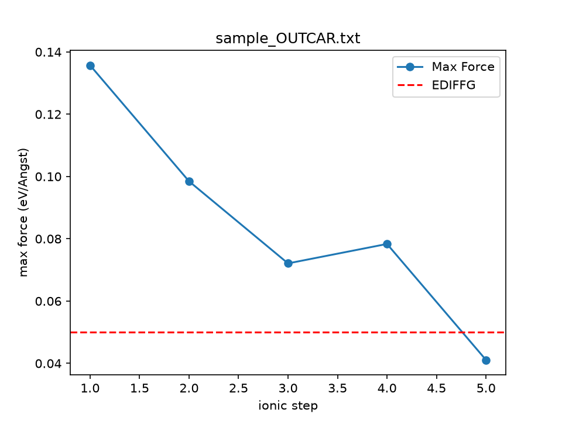

# vasp-tools

处理 VASP 输出文件的小工具集。目前两个脚本：一个看**算例收敛了没**，一个把**力是怎么降下来的**画成图。

仓库里的 `sample_OUTCAR.txt` 是**为演示构造的迷你样本**（只有 5 个离子步，内容被大幅删减，数值是编的，不代表任何真实计算）—— 下面所有命令都拿它跑，克隆下来就能直接照抄。

## read_outcar.py —— 看每个算例收敛了没

一次读多个结构优化算例的 OUTCAR，报出每个算例的离子步数、最终能量、以及结构优化是否收敛。

### 为什么需要它

OUTCAR 里能量值非常多，全混在一起。其中只有一部分是**离子步**的能量（真正在优化结构的那一步），其余属于**电子步**（每一步内部的中间产物）。

人工去数是很容易数错的。作者手上一个 RuO2 算例：

```
grep -c TOTEN OUTCAR
```

给出 **171** 行，而真正的离子步只有 **10** 个 —— 多出来的 161 行全是电子步。这两种行**只差一个空格的位置**，肉眼和 grep 都很难分：

```
free energy    TOTEN  =   ...   ← 电子步（空格在 energy 后面）
free  energy   TOTEN  =   ...   ← 离子步（空格在 free 后面）
```

### 怎么用

在包含 OUTCAR 的文件夹中运行：

```
python read_outcar.py sample_OUTCAR.txt
```

一次给多个文件也可以，会依次处理。先造一个第二份样本（需要 `grep`，Linux / macOS / Git Bash 都有）：

```
grep -v "reached required accuracy" sample_OUTCAR.txt > notconv.txt
```

这条命令只是把收敛标志那一行删掉，所以 `notconv.txt` 是一个**没跑完**的算例。再把它和原文件一起丢进去：

```
python read_outcar.py sample_OUTCAR.txt notconv.txt
```

命令行里什么都不给时，会打印用法提示，而不是默默退出：

```
python read_outcar.py
```

### 输出

上面最后一条命令的输出：

```
sample_OUTCAR.txt 离子步数: 5 收敛状态: 收敛 最终能量: -18092.44087654 eV
notconv.txt 离子步数: 5 收敛状态: 未收敛 最终能量: -18092.44087654 eV
```

一个文件一条结果，开头是文件名。

**`收敛状态` 判断的是"结构优化是否收敛"**（VASP 的判据是**力**，由 INCAR 里的 `EDIFFG` 设定），**不是**能量是否收敛。所以"收敛"并不代表能量到了最低点 —— 见下一节。

不带参数运行：

```
用法: python read_outcar.py <OUTCAR 路径> [可以给多个]
```

## plot_forces.py —— 把力怎么降下来的画出来

读一个 OUTCAR，画出**每个离子步的最大受力**，并把收敛线一起画出来。

### 怎么用

```
python plot_forces.py sample_OUTCAR.txt
```

同样支持多个文件，一次给几个就出几张图（`notconv.txt` 先按上一节造出来）：

```
python plot_forces.py sample_OUTCAR.txt notconv.txt
```

### 输出

每条输入对应一个图片文件，名字是在原文件名后面加 `_forces.png`，终端同时把名字打出来：

```
sample_OUTCAR.txt 已写出 sample_OUTCAR.txt_forces.png
notconv.txt 已写出 notconv.txt_forces.png
```



### 图怎么看

- **蓝色的点** = 第 N 个离子步时，所有原子中**最大的那个力**（单位 eV/Å）
- **红色虚线** = 收敛线，也就是 INCAR 里 `EDIFFG` 的绝对值
- 判据是"**第一次跌到红线以下**"，不是"力最小"。VASP 一旦看到某一步的最大力低于阈值，就不再挪离子了

**力不是一路往下掉的**，中途会反弹。上面这张图里第 4 步就比第 3 步高。所以"曲线最低的那个点"和"VASP 停下来的那个点"经常不是同一个。

由此还有一个反直觉的结果：**最后一步的能量不一定是最低的**。作者那个 RuO2 算例，第 8 步能量最低（−1809.02362388 eV），但它的力还差一点没过线，VASP 于是又走了两步，停在第 10 步（−1809.02271185 eV，略高）。所以报告能量要用**最后一步**，不能用 `min()`。

⚠️ **红线位置是写死的 `0.05`**，那是作者算例 INCAR 里 `EDIFFG=-0.05` 的值。**换一个 `EDIFFG` 不同的算例，要记得改 `plot_forces.py` 里那个 `0.05`**，否则红线画错了位置，图会骗人。

## 环境

Python 3.11（作者用的是 conda 环境）。

- **`read_outcar.py`**：只用标准库，无第三方依赖
- **`plot_forces.py`**：**需要 matplotlib**（`pip install matplotlib`）。没装的话会在 `import matplotlib.pyplot as plt` 那一行直接报 `ModuleNotFoundError`
